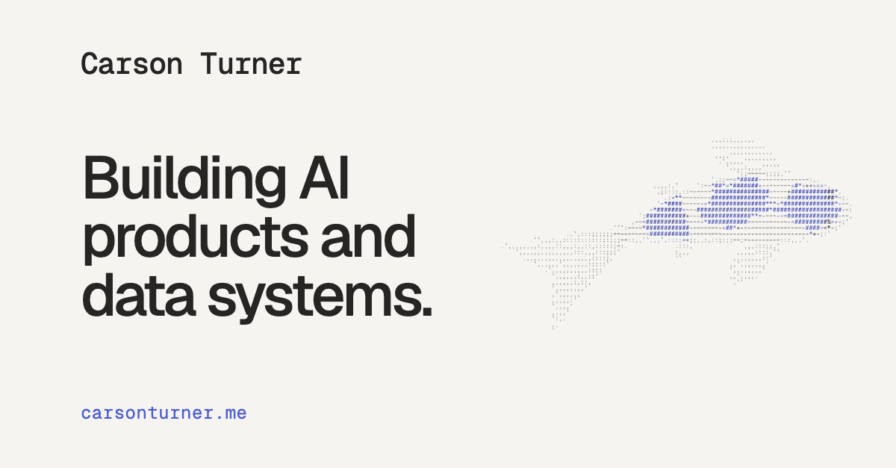

  

### `01` building

**[Sway](https://swaygrowth.com)** · growth analytics for iOS subscription apps 
TypeScript · Hono · React · Postgres · Claude

**[Manta](https://mantamarkets.com)** · market data and pricing for prediction markets 
Go · Python · Postgres · Next.js

**[Rapha](https://getrapha.co)** · personalized devotional app for iOS 
SwiftUI · Supabase · Claude

### `02` stack

TypeScript · Python · Go · Swift · React · Next.js · Postgres · Supabase · Claude

### `03` code

Most of my work lives in private repos. Happy to walk through any of it.

### `04` elsewhere

[carsonturner.me](https://carsonturner.me) · [linkedin](https://www.linkedin.com/in/carsonturner1/) · [email](mailto:carsonturnersf@gmail.com)
