## Carson Turner

Software engineer at Krastor and a track athlete at Ole Miss. More at [carsonturner.me](https://carsonturner.me).

  

### Current projects

- **[Sway](https://swaygrowth.com)**: shows iOS subscription apps which posts and ads bring in paying subscribers, with an AI agent that manages Meta ad spend under founder approval and spend limits.
- **[Manta](https://mantamarkets.com)**: a live analytics terminal for Kalshi and Polymarket that prices 5,000+ contracts against independent fair values.
- **[Rapha](https://getrapha.co)**: a devotional app on the App Store that writes each user a personal plan and adapts it every month.

### Krastor

Work with small businesses in real estate, construction and the building trades: an online design-and-price tool for a cabin builder, and a website, store and CRM for a building-materials manufacturer, with AI agents that draft customer follow-ups.

### Previously

CRM and outreach automation at McCarren Capital. Founded Swift Flight, an Amazon business that grew from online arbitrage to distribution with health and wellness brands ($700K+ in revenue).

### Stack

TypeScript · Python · Go · Swift · React · Next.js · Postgres · Supabase · Claude
