## Hi 👋, I'm Carson

**Full-stack & mobile engineer building AI agents, web apps, and iOS apps for real businesses.** 
CS @ Ole Miss · TypeScript · React · Swift · Python · Postgres

  

I build software that takes work off a business owner's plate. Day to day, that means shipping websites, internal tools, and AI agents for small businesses in construction, the building trades, and real estate. I own every build from scoping through deployment and maintenance.

I came to engineering from paid acquisition on Meta and TikTok, so I build with the business outcome in mind, not just the spec.

---

## 💼 What I do

**Lead developer, [Krastor Inc](https://krastor.com) (2025–present)** 
I'm the sole engineer on a two-person studio that ships AI-native systems for small businesses.

- 🤖 **AI agents in production:** email follow-up agents that work leads and quotes without anyone babysitting them
- 💸 **Quote-to-cash systems:** quoting, follow-up, and payment flows inside a custom ops dashboard ("command center")
- 🌐 **Marketing sites and rebuilds:** fast, conversion-focused sites for trades and outdoor businesses
- 🛠️ **Self-serve dev environments:** set up Claude Code, GitHub, and Vercel pipelines so non-technical clients can ship their own site updates safely

---

## 🛠️ Tech stack

### Languages and frontend

### Mobile
&nbsp;

### Backend and infra

### AI

---

## 🚀 Featured projects

### 🧩 [Mosaic](https://mosaicads.vercel.app): AI creative strategist for Meta ads
Breaks ad creatives down scene by scene with vision models, ties the results to performance using empirical-Bayes statistics, and recommends what to make next. Every claim cites its source data. 
`Gemini` `Claude` `Postgres` `pgvector` `Evals in CI` · [Code](https://github.com/carsonturnr/mosaic) · MVP Dec 2026

### 🏃 [Stride Lab](https://trystridelab.vercel.app): motion-capture running analysis from your phone
Turns treadmill or race footage into eleven research-backed biomechanics metrics, including a fatigue breakdown measured against your own fresh baseline. Includes an AI coach that's grounded in the measured numbers. 
`Python` `Computer vision` `FastAPI` `Modal` · [Code](https://github.com/carsonturnr/stride-lab) · Early 2027
