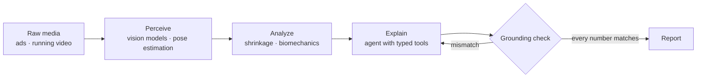

### Hi, I'm Carson.

I build applied-AI products: pretrained perception, domain-specific analytics, and LLM agents that show their work.

I came to engineering from paid social and direct-response marketing, and I still race the 800m. The two projects below come straight out of those worlds: one does the job of a creative strategist for ad accounts, the other does the job of a motion-capture lab for runners.

---

## Building now

<table>
<tr>
<td width="50%" valign="top">

### [Mosaic](https://github.com/carsonturnr/mosaic)

**An AI creative strategist for Meta ads.**

Connect an ad account and Mosaic breaks every creative down scene by scene, ties what it sees to performance, and says what to make next. Every claim cites the ads and numbers behind it.

- Vision models tag hooks, angles, formats and offers as schema-validated JSON
- Empirical-Bayes shrinkage so a $40 ad never gets crowned the winner
- Strategist agent with typed tools and a grounding check on every cited number
- Evals in CI against a synthetic account with planted patterns

`TypeScript` `React` `Python` `FastAPI` `Supabase` `pgvector` `Modal` `Gemini` `Claude`

[**Live site**](https://mosaicads.vercel.app) · [**Code**](https://github.com/carsonturnr/mosaic) · MVP December 2026

</td>
<td width="50%" valign="top">

### [Stride Lab](https://github.com/carsonturnr/stride-lab)

**A motion-capture lab in your phone.**

Upload footage from a treadmill, a workout or a race and get a research-backed breakdown of injury risk, efficiency and symmetry, including where your form breaks down when you're tired.

- Tap yourself once in race footage and get tracked through the clip
- Eleven metrics drawn from published biomechanics research
- Fatigue breakdown against your own fresh baseline, step by step
- A coach grounded in the measured numbers, never a diagnosis

`Python` `RTMPose` `YOLO` `ByteTrack` `Modal` `React` `Supabase` `Claude`

[**Live site**](https://trystridelab.vercel.app) · [**Code**](https://github.com/carsonturnr/stride-lab) · Launching early 2027

</td>
</tr>
</table>

## The pattern

Both projects share one architecture: turn raw media into structured facts, reason over those facts with real statistics, then let a model explain them, and check that it told the truth.

## Toolbox

- **Languages:** TypeScript · Python · SQL
- **Product:** React · Vite · Tailwind · Vercel
- **Data and infra:** Postgres · Supabase · pgvector · FastAPI · Modal
- **AI:** Gemini · Claude · structured outputs · tool use · evals · Langfuse
- **Domain:** Meta Marketing API · paid social · direct response · DTC funnels · running biomechanics
